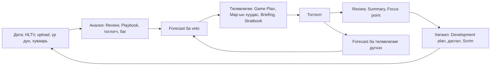
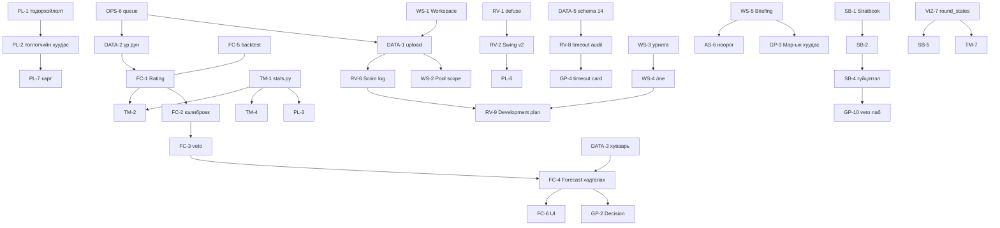

# cs-analyze: хөгжлийн төлөвлөгөө (2026-10-21)

> Нэг багийн дасгалжуулагч, analyst-ийн үүднээс бичив. Бүтээгдэхүүн хоёр зүйлд туслах ёстой: өрсөлдөгч ба өөрийн багийн тоглогчдын давуу, сул талыг олох, ирээдүйн ялалтыг хэмжигдэхүйц таамаглах. Үүний тулд одоогийн кодыг аудит хийж, зах зээл, судалгаа, pro багуудын ажлын арга, CS2-ийн дата эх сурвалжуудыг судалсан (`12-research-sources.md`). Чиглэл бүр тусдаа файлтай. Энэ файл нь тэдгээрийн нийт дүр зураг ба дараалал.
>
> Нэр томъёо `CONTEXT.md`-д, шийдвэр `docs/adr/`-д байна. Grilling-ийн үеэр шинээр орсон нэр томъёо: Workspace, My team, Staff, Scrim, Rating, Forecast, Briefing, Stratbook, Strat, Development plan. Шинэ ADR: 0010, 0011.

## Алсын хараа: дасгалжуулагчийн битүү хүрээ

**Одоо байгаа хэсэг:** хүрээний эхний хагас (Дата → Анализ → Game Plan → Review) Азийн tier-2 багт зах зээлд байгаа ихэнх хэрэгслээс гүнзгий [таамаг] (`12`, §1).

**Байхгүй хэсэг:**

- Forecast
- Өөрийн дата (Scrim)
- Хуваалцах (Briefing)
- Хөгжлийн хэмжилт (Development plan)
- Strat-ийн номын сан
- Автомат хуваарь

Эдгээрийг холбох нь энэ төлөвлөгөөний гол зорилго.

## Одоогийн байдал: товч дүгнэлт

**Сайн байгаа зүйлс:**

- **Pipeline:** Cloudflare-ийн цаана ч ажилладаг HLTV pipeline. Demo part-ыг нэгтгэнэ. Tick Data MySQL-д хадгалагдаж, demo-гүйгээр дахин parse хийгдэнэ.
- **Review:** Win probability, Swing, 32 Finding. Summary нь Focus point-той.
- **Playbook:** Evidence strength, Replay-ийн ref-тэй. Levers ба Cautions нь reliability-аар жигнэсэн.
- **Бусад:** Loadout-тэй Replay. Монгол хэл, дуутай Assistant.
- **Чанар:** 166 тест бүгд амжилттай, lint цэвэр.

**Гол асуудал** (дэлгэрэнгүй нь файл бүрийн "Одоогийн байдал" хэсэгт):

| Төрөл | Асуудал | Хаана |
|---|---|---|
| Аюулгүй байдал | `GET /workers` Redis-ийн нэр, нууц үгтэй broker URL-ыг бүх хэрэглэгчид харуулдаг. Backup огт байхгүй. Root эрх. Rate limit байхгүй | `11` OPS-1, OPS-2, OPS-4 |
| Тооны зөв байдал | Defuse эхэлсэн үед Win probability 0 болж унадаг тул defuse-ийн 29%-д +1.0 Swing оноогддог | `07` RV-1 |
| Тооны зөв байдал | Pistol-ыг overtime-тай нь тоолдог. Trade-ийн 3 тодорхойлолт. Тоглогчийг нэрээр тааруулдаг | `04` PL-1 |
| Тооны зөв байдал | Habit-ийг base rate-тай харьцуулдаггүй (retake "сул" 94-ийн 70-д). SD floor бодит тархалтыг дардаг | `05` TM-1, TM-4 |
| Таамаглал | Forecast, Rating байхгүй. Decision 12 үзүүлэлтийг тоолдог, өрсөлдөгчийн хүчийг тооцдоггүй ("Huns vs MongolZ 12/12 давуу") | `03`, `06` GP-2 |
| Дата | Window ≤5, results-ийн эхний хуудас л. Upload байхгүй. 113 Map-ийн 104 нь Loadout-гүй, 107 нь Sighting-гүй | `02` |
| Багийн ажил | Тоглогчийн хуудас, хуваалцах, тэмдэглэл, Stratbook, Development plan, хуваарь байхгүй. Бүх хэрэглэгч тэгш эрхтэй | `01`, `04`, `07`, `08` |

## Grilling-ийн шийдвэрүүд (2026-10-21)

| # | Шийдвэр |
|---|---|
| Q1, Q6 | Одоо нэг клуб. Хувийн дата эхнээсээ Workspace-д харьяалагдана. Нэг Workspace олон my team-тэй байж болно (ADR 0011) |
| Q2, Q5 | HLTV үндсэн эх хэвээр. Нэмэх дараалал: ① өөрийн upload → ② хуваарь, roster, ranking → ③ FACEIT, Premier |
| Q7 | Scrim зөвхөн өөрийн хөгжилд. Own form, habit, Pool, Rating-д тооцохгүй (ADR 0010) |
| Q13 | HLTV-д ороогүй official upload Workspace дотроо HLTV Match шиг тооцогдоно |
| Q8, Q14 | Staff бүгдийг харна. Тоглогч өөрийнхөө Review, Focus point, Development plan ба хуваалцсан зүйлийг харна. Staff апп дотроос урина |
| Q3, Q12 | Тоглолтын өмнөх Forecast. Бүгд хадгалагдаж дүгнэгдэнэ. Нэр томъёо нь Rating ба Forecast |
| Q9 | Rating-ийг дэлхийн бүх багийн үр дүнгээс (demo-гүй) тооцно |
| Q15 | Forecast default-аар зөвхөн Staff-д. Briefing-д оруулах эсэхийг Staff сонгоно |
| Q16 | Stratbook P1-д |
| Q10 | Одоогийн host, бага төсөв. Босгод хүрэхэд л шилжинэ |
| Q4, Q11 | Монгол, хэрэгжүүлэхэд бэлэн. P0/P1/P2, S/M/L, огноогүй |

**Миний сонгосон default-ууд:**

- UI монгол хэвээр, англи хэл P2.
- Live (тоглолтын үеийн) анализ хамрахгүй.
- Upload нь chunked болон URL-аар (Cloudflare-ийн 100 MB хязгаарын улмаас).
- Forecast эхлээд үр дүнд суурилсан Rating-аар хийгдэнэ. Нэмэлт онцлог backtest-ийг давсан үед л орно.
- Bookmaker odds-ыг зөвхөн benchmark болгон P2-т, integrity-ийн анхааруулгатай ашиглана.

## Чиглэлүүд

| Файл | Чиглэл | Гол item-ууд |
|---|---|---|
| [01-workspace-access.md](01-workspace-access.md) | Workspace, эрх, урилга, тоглогчийн нүүр, Briefing | WS-1 Workspace · WS-3 урилга · WS-4 `/me` · WS-5 Briefing · WS-6 нэвтрэлт |
| [02-data-sources.md](02-data-sources.md) | Upload, дэлхийн үр дүн, хуваарь, Scout v2, parse, FACEIT | DATA-1 upload · DATA-2 үр дүн · DATA-3 хуваарь · DATA-8 parse QA |
| [03-ratings-forecast.md](03-ratings-forecast.md) | Rating, Forecast, veto симуляци, backtest | FC-1 Rating · FC-3 veto · FC-4 хадгалах, дүгнэх · FC-5 backtest |
| [04-player-analytics.md](04-player-analytics.md) | Тоглогчийн хуудас, давуу/сул тал, үүрэг, aim | PL-1 тодорхойлолт · PL-2 хуудас · PL-3 статистик · PL-7 өрсөлдөгчийн карт |
| [05-team-analytics.md](05-team-analytics.md) | Нийтлэг статистик, хэв маяг, map pool, эдийн засаг | TM-1 `stats.py` · TM-2 өрсөлдөгчөөр тохируулах · TM-4 base rate · TM-5 хэв маяг |
| [06-game-plan.md](06-game-plan.md) | Game Plan, Map-ын хуудас, timeout card, veto лаборатори | GP-1 засвар · GP-2 Forecast · GP-3 Map-ын хуудас · GP-8 төлөвлөгөөний шалгалт |
| [07-review-development.md](07-review-development.md) | Review-ийн зөв байдал, WP v2, Development plan, agenda | RV-1 defuse · RV-2 Swing v2 · RV-4 WP v2 · RV-9 Development plan |
| [08-stratbook.md](08-stratbook.md) | Stratbook, lineup, Strat-ийн гүйцэтгэл | SB-1 загвар · SB-3 lineup · SB-4 хэмжилт · SB-7 нууцлал |
| [09-replay-visuals.md](09-replay-visuals.md) | Replay, ghost горим, раунд хайх, heatmap | VIZ-5 давхарлах · VIZ-7 хайлт · VIZ-9 heatmap v2 |
| [10-assistant.md](10-assistant.md) | Assistant: засвар, зардал, tool, grounding, Briefing-ийн ноорог | AS-1 · AS-2 · AS-3 · AS-4 · AS-6 |
| [11-platform.md](11-platform.md) | Аюулгүй байдал, backup, CI, queue, ажиглалт, гүйцэтгэл | OPS-1 · OPS-2 · OPS-3 · OPS-6 |
| [12-research-sources.md](12-research-sources.md) | Эх сурвалж ба гол баримтууд | — |

## Roadmap

### P0-а. Энэ долоо хоногт: эрсдэл ба буруу тоо

| Item | Юу | Хэмжээ |
|---|---|---|
| OPS-1 | `/workers`-ийн нууц, download-ийн watchdog, Review-ийн queue, rate limit, `/docs` хаах | S |
| OPS-2 | Шөнийн backup, host-оос гадуур, сэргээлтийн дасгал | S–M |
| RV-1 | Defuse-ийн уналт, `REVIEW_SCHEMA` ахиулах | S |
| PL-1, GP-1 | Pistol, Trade, Steam id, Decision-ийн өгүүлбэр, caption | S |
| DATA-8, DATA-10 | Parse-ийн чанарын шалгалт, датаны бодлого | S |

**Хүний шийдвэр шаардах алхмууд:**

1. Production-д нэвтэрсэн хэрэглэгчдэд харагдаж байсан cstat-ийн Redis ACL нууц үгийг солих. Энэ cstat-д ч нөлөөлнө.
2. FACEIT Downloads API-д өргөдөл гаргах. Хянах хугацаа ~30 хоног, интеграц нь P2.

### P0-б. Суурь

1. OPS-3: CI, deploy gate.
2. WS-1: Workspace, role, scope helper.
3. AS-1, AS-2: Assistant-ийн засвар, зардлын бүртгэл.
4. RV-3: detector-ийн тест (эхний хэсэг).
5. TM-1: `stats.py`.
6. PL-2: тоглогчийн хуудас v1.

### P0-в. Дата ба Forecast

1. OPS-6: queue.
2. DATA-1: upload, эхний хувилбар.
3. WS-2: Pool-ийн Workspace хамаарал.
4. DATA-2: үр дүнгийн сан, эхний үе.
5. FC-1 + FC-5: Rating v1, backtest.
6. FC-2: калибровк.
7. FC-3, FC-4: veto, Forecast-ыг хадгалж дүгнэх.
8. GP-2: Decision → Forecast.

### P1. Дараагийн шат

**Хуваалцах ба тоглогчид:**

- WS-6 → WS-3 → WS-4, WS-5 (Briefing).
- PL-3, PL-4, PL-7, PL-8, PL-6, PL-5.
- AS-6: Briefing-ийн ноорог.

**Өрсөлдөгчийн бэлтгэл:**

- DATA-3 (хуваарь, автомат Scout), DATA-4 (Scout v2).
- TM-2, TM-3, TM-4, TM-5, TM-6, TM-9.
- GP-3 Map-ын хуудас, GP-4 timeout card, GP-5 pistol, GP-6, GP-9, GP-10 veto лаборатори, GP-11 Self-scout, GP-7 хэвлэх, GP-12 гүйцэтгэл.
- FC-6, FC-9.

**Өөрийн багийн хөгжил:**

- RV-5 → RV-2 + RV-4 (нэг `REVIEW_SCHEMA`).
- RV-6 Scrim-ийн log, RV-7 тэмдэглэл ба playlist, RV-8 timeout audit, RV-9 Development plan, RV-10 agenda.
- GP-8 төлөвлөгөөний шалгалт.

**Stratbook:** SB-1, SB-7, SB-2, SB-3, SB-6, SB-4.

**Visual:**

- VIZ-2, VIZ-6, VIZ-11 → VIZ-1 → VIZ-5, VIZ-3, VIZ-4 → VIZ-9 → VIZ-7 (раунд хайх) → VIZ-8.
- TM-7: VIZ-7-ийн `round_states`-ийн дараа.

**Дата ба платформ:**

- DATA-5 (schema 14), DATA-7 (patch-ийн үе), DATA-9 (самбар).
- OPS-4, OPS-5, OPS-8, OPS-9.
- AS-3, AS-4, AS-5, AS-7.

### P2. Хожим

- WS-7 audit log
- DATA-6 FACEIT, Premier
- FC-7 VRS ба тэмцээний симуляци, FC-8 Bayesian Rating v2, FC-10 odds-ын benchmark
- PL-9 шинэ тоглогч, PL-10
- TM-8 эдийн засгийн model, TM-11 momentum
- GP-13, GP-14
- RV-11 дасгалын календар, RV-12 шинэ detector
- SB-5, SB-8
- VIZ-10, VIZ-12, VIZ-13
- AS-8, AS-9
- OPS-7 (босго хүрэхэд), OPS-10

## Гол хамаарлууд

## Coach-ийн долоо хоног бүтээгдэхүүнд

Tier-2 багийн долоо хоногийн мөчлөгийн загвар (`12`, §4) ба түүнийг дэмжих item-ууд:

| Өдөр | Coach юу хийдэг | Бүтээгдэхүүн юугаар туслах |
|---|---|---|
| Даваа | Тоглолтын review, Development plan-ий хяналт | RV-10 agenda, RV-7 playlist, RV-9 явц, GP-8 төлөвлөгөөний шалгалт |
| Мягмар–Лхагва | Онол, Scrim, review, retake/prefire | DATA-1 upload → 5 минутад Review, RV-6 Scrim-ийн KPI, SB-4 Strat-ийн гүйцэтгэл |
| Пүрэв | Өрсөлдөгчийн бэлтгэл, veto түгжих, pistol | DATA-3 автомат Scout, FC Forecast, GP-10 veto лаборатори, GP-3 Map-ын хуудас, GP-5 pistol |
| Баасан | Тоглолт | WS-5 Briefing (утсан дээр), GP-4 timeout card, Map хоорондын хуудас |
| Бямба | Scrim, дараагийн өрсөлдөгч | FC-4 Forecast-ын дүн, DATA-3 дараагийн тоглолт |

## Амжилтын хэмжүүр

| Хэмжүүр | Зорилт | Item |
|---|---|---|
| Forecast-ын нарийвчлал (veto мэдэгдсэн үеийн Map) | log loss ≤0.66, Brier ≤0.23, калибровк хийсэн VRS-ээс сайн | FC-4, FC-5 |
| Anti-strat-ийн нарийвчлал | Briefing-д таамагласан habit-уудын ≥60% нь тоглолтод гарах | GP-8 |
| Briefing бэлдэх хугацаа | ≤30 минут (3 Map + timeout card) | WS-5, GP-3 |
| Scrim-ийн Review | Upload-аас хойш ≤5 минут | DATA-1 |
| Датаны хамрах хүрээ | My team ба дараагийн өрсөлдөгчийн сүүлийн 3 сарын Match-ийн ≥90% нь Loadout, Sighting-тай parse хийгдсэн | DATA-4, DATA-9 |
| Найдвартай байдал | Дата алдагдахгүй (сар бүрийн сэргээлтийн дасгал), гацсан job-ийг 2 минутад илрүүлэх | OPS-2, OPS-1 |
| Game Plan-ийн хурд | Хамгийн хүнд tab ≤10 s | GP-12 |

## Энэ баримтыг хэрхэн хөтлөх

- **Item-ийн ID:** item-ийн ID (`WS-3`, `FC-1` …) нь commit, PR-ийн гарчигт орно. Хийгдсэн item-ийн гарчгийн ард ✅ ба commit-ийн hash нэмнэ.
- **Нэр томъёо ба шийдвэр:** шинэ нэр томъёог `CONTEXT.md`-д, буцаахад хэцүү шийдвэрийг ADR-д бичнэ (CLAUDE.md-ийн grill-with-docs).
- **"Одоогийн байдал":** кодын томоохон өөрчлөлтийн дараа холбогдох хэсгийг шинэчилнэ. Тоонууд 2026-10-21-ний локал DB-ийнх.
- **Шинэ ажил:** эхлэхээсээ өмнө холбогдох файлын item-ийг уншина. Item нь зорилго, хүлээгдэх үр дүнтэй тул түүнийг grilling-ийн эхлэл болгоно.
