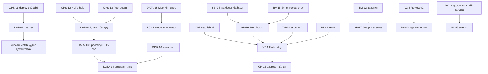

# v2-update: дасгалжуулагч-аналистын дараагийн шат (2026-11-16)

> Багаа хожуулах гэж байгаа дасгалжуулагч, analyst-ийн нүдээр бичив: одоо байгаа төсөл ба v2 дээр цаашид юу хийвэл тоглолт хожиход хамгийн их тус болох вэ. Уншигч нь энэ repo дээр ажиллах **Claude** (LLM). Тиймээс item бүр эхлэх файл, алхам, хүлээн авах шалгуур, тест, grilling-д асуух асуулттай.
>
> Суурь баримтууд: `CLAUDE.md` (архитектур), `CONTEXT.md` (нэр томъёо), `docs/adr/` (шийдвэр), `docs/plans/README.md` ба `01`–`12` (өмнөх төлөвлөгөө, item-ийн төлөв). Энэ файл тэдгээрийг орлохгүй, үргэлжлүүлнэ: item-ийн ID өмнөх бүлгүүдийн дугаарыг (DATA-11, OPS-11 …) үргэлжлүүлж, v2-ийн дэлгэцийн ажилд `V2-` гэсэн шинэ бүлэг нэмэв.
>
> Тэмдэглэгээ: **(хэмжсэн)** гэдэг нь 2026-11-15/16-нд production эсвэл локал дээр хэмжсэн тоо. **[таамаг]** гэдэг нь шалгаагүй тооцоо буюу санал. Таамгийг хэрэгжүүлэхээс өмнө хэмжиж батална.

## 0. Claude-д: энэ баримтаар яаж ажиллах

1. **Нэг item = нэг ажил.** Item-ийг авахаасаа өмнө «Одоо» хэсэгт нэрлэсэн файлуудыг уншиж, кодын одоогийн байдалтай тулга. Энэ баримт 2026-11-16-ны байдлаар бичигдсэн; код урагшилсан бол кодыг дагана.
2. **Эхлээд grill** (`CLAUDE.md` → «Workflow: always grill with docs first»). Item бүрийн «Grill» хэсэгт хэрэглэгчээс асуух гол асуултууд байгаа. Тэдгээрийг `AskUserQuestion`-оор, санал болгож буй хариугаа эхэнд нь «(Recommended)» гэж тэмдэглээд асуу. Хариу авсны дараа үлдсэн шийдвэрийг өөрөө гаргана.
3. **Нэр томъёо ба шийдвэр:** шинэ нэр томъёо `CONTEXT.md`-д, буцаахад хэцүү шийдвэр ADR-д. Энэ баримтын §9-д нэр томъёоны саналууд бий; grill-д батлагдсаны дараа л `CONTEXT.md`-д орно.
4. **Дууссаны шалгуур (item бүрт):** `npm run test:api`, `npm run test:public`, `npm run lint` цэвэр; API-ийн schema өөрчлөгдсөн бол `npm run openapi` хийж хоёр файлыг commit; `CLAUDE.md`-ийн холбогдох хэсгийг шинэчил; энэ файлд item-ийн гарчгийн доор `> **Төлөв:** ✅ <commit>` мөр нэм.
5. **Stored answers (ADR 0014):** шинэ аналитик endpoint бүрийг `@answers.kind(...)`-оор бүртгэж, `warmer`-ийн төлөвлөгөөнд нэмж, `tests/test_answers.py`-ийн «хуудас яг warm-up-ийн хадгалсан түлхүүрээр асууна» тестэд URL-ыг нь оруул. Хуудасны хэлэх зүйл эсвэл хэлбэр өөрчлөгдвөл тухайн kind-ийн version-ийг ахиул. Staff гараар засдаг зүйлийг `live` hook-оор уншина.
6. **Production-ийн дүрэм:**
   - Push, deploy-г зөвхөн хэрэглэгч хэлсэн үед хийнэ. 2026-11-16-ны заавар: **job-ууд дуустал deploy хийхгүй.**
   - Prod дээр account үүсгэхгүй, нууц үг бичихгүй. Унших ажилд `cd /home/cs2.bizon.mn/apps/api && PYTHONPATH=. .venv/bin/python` (`uv run` биш).
   - Parse явж байхад prod дээр хүнд хэмжилт хийхгүй: 2026-11-15-нд available RAM ~2 GB хүртэл буусан.
   - HLTV: match page-үүдийг 8 с-ийн зайтай; ~45 хуудсыг ойрхон уншихад Cloudflare host-ыг хаасан (2026-11-12).
   - Төлбөртэй зүйл (Assistant-ийн eval, тогтмол ажиллах LLM дуудлага, шинэ host) хэрэглэгчийн зөвшөөрөлтэй.
7. **Хэмжээ:** S ≤ 1 өдөр, M = 2–4 өдөр, L ≥ 1 долоо хоног (өмнөх төлөвлөгөөний адил, огноогүй).

## 1. Одоогийн байдал (2026-11-16)

### 1.1 Байгаа зүйл

Дата → анализ → төлөвлөгөө → тоглолт → review → хөгжил гэсэн хүрээний бүх хэсэг кодонд бий (`README.md`-ийн «Байхгүй хэсэг» жагсаалт бүгд хийгдсэн): Scout ба Team Scout, upload, Review ба Summary, Playbook, Tell, Veto, Forecast, veto lab, Briefing, тоглолтын дараах шалгалт, Stratbook, Development plan, Practice schedule, Assistant. v2 (`/v2/t/:team/...`) нь 10 дэлгэц ба Self-scout-тай; Scout, job, upload, Briefing, Stratbook, Forecast, Workspace нь v1-ийн хуудсаар `Legacy` дотор нээгдэнэ.

2026-11-15-нд нэмэгдсэн:

- **Team Scout** (`a429f39`): нэг багийн сүүлийн 1–40 тоглолт.
- **Stored answers ба warm-up** (`be17acc`, ADR 0014): аналитик хуудас бүрийн хариу `stored_answers`-д хугацаагүй хадгалагдаж, worker урьдчилан тооцоолно; parse-ийн дараа хуучин хариу шууд гарч, ар талд шинэчлэгдэнэ.
- **Scout deploy-оос амьд гарна** (`be17acc`, `c821cb6`): worker унтрахад Scout дараагийн алхам дээрээ зогсоод дарааллын эхэнд буцна.

### 1.2 Хэмжсэн баримтууд

| Юу | Тоо | Эх |
|---|---|---|
| Parse хийсэн Map | 524 (өглөө 474) | prod, 11-15 20:26 UTC |
| MySQL | 6.79 GB; `tick_datasets` 5.89 GB (~11.2 MB/Map); диск 53/158 GB (36%) | prod |
| Host | 2 vCPU, 7.4 GB RAM, cstat-тай хуваалцсан | prod |
| Дараалал | `demo` хэрэглэгч 47 Team Scout оруулсан (20–40 тоглолт тус бүр); 45 нь хүлээж байна | prod |
| Нэг Team Scout | job 50 (Vitality, 20 тоглолт): 17 архив, 43 Map задалж 38-ыг parse хийсэн, 3 цаг 33 мин | prod |
| Stored answers-аас өмнөх удаан хүсэлт | `/teams/N` 77 с хүртэл, `/v2/teams/N/overview` 82 с хүртэл, Game Plan tab 40–68 с, Map-ийн Playbook 25–54 с, style 10–33 с | prod log, 10-20…11-15 |
| Warm-up-ийн эхний тойрог | 3.8 цагт 1,674 хариу (7.3/мин), алдаа 0; төлөвлөсөн 7,733 хуудас, ~110 fixture | prod, parse-тай зэрэгцэн |
| Хуудасны тооцооллын дундаж (prod, давалгааны үед) | `gp.panel` 6.9 с (max 104 с), `gp.playbook` 8.2 с, `gp.style` 8.9 с, `v2.utility` 12.7 с, `team.page` 5.0 с | `stored_answers.compute_ms` |
| Хадгалсан хариуг унших | 13–57 ms (локал) | `Server-Timing` |
| **Parse-ийн алдаа** | job 47, 49, 50, 51-д нийт 27 Map: `awpy could not parse …: EntityNotFound` / `IllegalPathOp`. Бүгд хамгийн сүүлийн тоглолтууд (FUT–MOUZ, Vitality–MOUZ, FURIA–Vitality …) | prod, `analysis_events` |
| Parser | prod: `awpy 2.0.2`, `demoparser2 0.42.0`; PyPI дээр `demoparser2 0.42.2`, `awpy 3.3.0` гарсан | prod, PyPI |

### 1.3 Дасгалжуулагчийн онош

Хэрэгсэл гүнзгий анализтай боловч багийг хожуулах гинжин хэлхээ таван газар тасардаг:

1. **Хамгийн шинэ дата алга.** Өрсөлдөгчийн өнгөрсөн долоо хоногийн тоглолт хамгийн үнэтэй, гэтэл яг тэдгээр нь parse хийгдэхгүй байна (DATA-11). Дата шинэчлэх нь гар ажил: 47 Team Scout-ыг хүн нэг нэгээр нь оруулсан (DATA-12).
2. **Найдвартай байдал масштабтай өсөөгүй.** HLTV хаавал дараалал хоосон «амжилттай» дуусч шатна [таамаг, кодоос уншсан] (OPS-12). Pool-ийн тооцоо Map-ийн тоотой шугаман өснө (OPS-13). Давалгааны дараа `tick_datasets` OPS-7-ийн босгод ойртоно (OPS-14).
3. **Тоглолтын өдрийн урсгал тарсан.** Veto lab, Map sheet, timeout card, Briefing нь v1-ийн тусдаа хуудсууд; таблет дээр нэг дэлгэцээс удирдах боломжгүй (V2-1…V2-3).
4. **Бэлтгэлийн хүрээ хаагдаагүй.** Өрсөлдөгчийн habit-д сонгосон counter → Strat → дасгал → Scrim-д гарсан эсэх → тоглолтод ажилласан эсэх гэсэн гинж хэсэг хэсгээрээ байгаа ч нэг самбарт алга (GP-16, SB-9, RV-15).
5. **Model-ууд хуучин дата дээр суусан.** Win probability, Pattern-ийн босго, Map-ийн offset 113–118 Map дээр тааруулагдсан; давалгааны дараа дата 4–5 дахин өснө [таамаг] (FC-11).

## 2. Зорилт ба хэмжүүр

| Хэмжүүр | Зорилт | Item |
|---|---|---|
| Шинэ demo-ийн parse | HLTV-д demo гарснаас 24 цагийн дотор ≥ 98% амжилттай | DATA-11 |
| Датаны шинэлэг байдал | Дагаж буй багуудын тоглолтын ≥ 90% нь 24 цагийн дотор parse хийгдсэн | DATA-12 |
| Дараалал шатахгүй | HLTV хаагдсан үед «0 хуудас уншаад амжилттай» дууссан job = 0 | OPS-12 |
| Scout-ийн дараах шинэчлэл | Тухайн fixture ≤ 5 мин, бүх fixture ≤ 60 мин [зорилт] | OPS-13, OPS-15 |
| Тоглолтын өдрийн бэлтгэл | Match day дэлгэц < 1 с нээгдэнэ; хэвлэх багц ≤ 10 мин | V2-1 |
| Anti-strat-ийн нарийвчлал | Сонгосон habit-ийн ≥ 60% нь тоглолтод гарах (GP-8-ын хэмжүүр), Prep board-оор мөр бүрээр | GP-16 |
| Тоглогчийн тайлан | Даваа бүр 5/5 тоглогчид хуваалцсан | RV-14 |
| Forecast | Map-ийн түвшинд log loss v1-ээс сайн (walk-forward) үед л асна | FC-11 |

## 3. Roadmap

### P0. Одоо: дата ба найдвартай байдал

| ID | Юу | Хэмжээ | Deploy |
|---|---|---|---|
| DATA-11 | Шинэ demo parse хийгдэхгүй байгааг засах, parse canary | S | job-уудын дараа |
| OPS-11 | Хүлээгдэж буй `c821cb6`-г deploy хийж, graceful stop-ийг батлах | S | job-уудын дараа |
| OPS-12 | HLTV хаагдахад дарааллыг шатаахгүй зогсоох | S–M | job-уудын дараа |
| OPS-13 | Pool-ийн тооцоог өсөлтөд бэлдэх (эхлээд хэмжих) | M | хэсэгчлэн |
| OPS-14 | Давалгааны дараах хадгалалтын хэмжилт ба шийдвэр | S (хэмжилт) | үгүй |
| FC-11 | Давалгааны дараах model-ийн шинэчлэл | M | тийм |

### P1. Дараагийн 3–5 долоо хоног

- **Автомат бэлтгэл:** DATA-12 дагах багууд → DATA-13 Upcoming match HLTV-ээс → OPS-16 Staff-ийн мэдэгдэл → DATA-14 тоглолтын өмнө/дараах гинж. DATA-15 Map-ийн оноо.
- **Тоглолтын өдөр:** V2-1 Match day → V2-2 veto lab v2 → V2-3 Briefing ба Map sheet утсанд → GP-16 Prep board → GP-15 Map-ийн дараах express тайлан.
- **Өрсөлдөгч:** TM-14 сүүлийн үеийн өөрчлөлт, PL-11 AWP-ийн зураг, TM-15 өөрийн buy-ийн audit.
- **Өөрийн баг:** RV-13 хурлын горим, RV-14 долоо хоногийн тайлан, RV-15 Scrim-ийн төлөвлөгөө, SB-9 Strat-ийн бэлэн байдал, PL-13 тоглогчийн нүүр v2.
- **v2:** V2-8 дараалал удирдах, V2-5 Match-ийн Review v2, V2-4 v1-д үлдсэн хуудсууд.
- **Платформ:** OPS-15 warm-up-ийг тааруулах, OPS-17 host-ын шийдвэр, OPS-18 сэргээлтийн дасгал.
- **Assistant:** AS-10 v2 хуудсуудын tool.

### P2. Хожим

TM-12 T раундын архетип → GP-17 Setup × execute; TM-13 CT түрэмгийлэл; PL-12 тоглогчийн хандлагын карт v2; RV-16 trade зай ба refrag; FC-12 veto-ийн policy; FC-7 тэмцээний Monte Carlo (өмнөх төлөвлөгөөнөөс); AS-11 өглөөний brief, AS-12 dossier, AS-13 тоглогчийн санал; V2-6 командын мөр, V2-7 offline, V2-9 «юу шинэчлэгдсэн», V2-10 англи хэл; GP-18 LAN/online шүүлтүүр.

### Хамаарал



## 4. P0 item-ууд

### DATA-11. Шинэ demo parse хийгдэхгүй байгааг засах (P0, S)

- **Яагаад:** дасгалжуулагчид өрсөлдөгчийн хамгийн сүүлийн 3–5 Map хамгийн чухал. Одоо яг тэдгээр нь унаж байна, татсан 500 MB-ийн архив дэмий болж, parser шинэчлэгдсэний дараа дахин татах шаардлагатай.
- **Одоо (хэмжсэн):** §1.2-ын мөр. `demo_parser.parse_map` (`app/services/demo_parser.py:722`) awpy-ийн алдааг `awpy could not parse <файл>: <алдааны нэр>` болгож өгдөг. Унасан Map-д `match_maps` мөр үүсдэггүй тул `/data`-ийн «хэзээ ч parse хийгдээгүй» тоонд л харагдана.
- **Таамаг:** 2026-11-11…13-ны хооронд гарсан CS2-ийн update demo-ийн форматыг өөрчилсөн, `demoparser2 0.42.2` үүнийг засдаг [таамаг, шалгаагүй].
- **Хийх:**
  1. **Давтах.** Локал дээр унасан нэг Match-ийн архивыг Scout-ийн өөрийн client-ээр тат (`HltvBrowser`, `HltvClient.match_page`/`demo_link`, `browser.download`, `archive`-аар задал; файлыг scratch-д үлдээ). `demo_parser.parse_map(path)` яг prod-ийн алдааг өгөх ёстой.
  2. **Ахиулах.** `cd apps/api && uv lock --upgrade-package demoparser2`, `uv sync`. awpy 2.0.2-ийн pin зөвшөөрөхгүй бол pin-ийг шалгаж шийд.
  3. **Шалгах.** Шинэ demo parse хийгдэнэ. Хуучин demo-г (`CS_ANALYZE_TEST_DEM`, `tests/test_real_demo.py`) өмнө ба хойно parse хийж `ParsedMap`-ийн раунд, kill, damage, throw-ийн тоо, Tick Data-ийн хүснэгтүүд ижил эсэхийг тулга: чимээгүй өөрчлөлт Review-г эвдэнэ.
  4. **0.42.2 засахгүй бол:** demoparser2-ийн issue/main-ийг шалга. awpy 3.x руу шилжих нь тусдаа L item (API өөр): эхлээд хэрэглэгчид мэдэгд.
  5. **Deploy-ийн дараа:** унасан Match-уудыг дахин тат. Жагсаалт: `analysis_events`-ийн `awpy could not parse` мөрүүд (job id → баг). Тухайн багуудад Team Scout (n=10) дахин оруулахад «хэзээ ч parse хийгдээгүй» Match-ууд дахин татагдана.
  6. **Урьдчилан сэргийлэх: parse canary.** `hltv:canary`-д `--parse` горим: дээд түвшний нэг багийн хамгийн шинэ demo-г татаж нэг Map parse хийнэ; унавал `alerts.send("parser", ...)`. Долоо хоног бүрийн `cs2-canary.timer`-т холбоно (≈ 500 MB/долоо хоног).
- **Хүлээн авах шалгуур:** нэрлэсэн гурван Match (FUT–MOUZ, Vitality–MOUZ, FURIA–Vitality) локал дээр parse хийгдэнэ; хуучин demo-ийн тоонууд өөрчлөгдөөгүй; canary унасан demo дээр alert өгнө (тест: `parse_map`-ийг алдаа шидүүлээд).
- **Grill:** canary-ийн долоо хоногийн 500 MB таталтыг зөвшөөрөх үү? Deploy-г job-уудын дунд (Scout үргэлжилнэ, OPS-11) хийх үү, эсвэл дуустал хүлээх үү: хүлээвэл давалгааны бүх багийн хамгийн шинэ тоглолтууд дутуу үлдэнэ.

### OPS-11. Хүлээгдэж буй deploy ба graceful stop-ийн баталгаа (P0, S)

- **Одоо:** `c821cb6` локал дээр commit хийгдсэн, push/deploy хийгээгүй: worker-ийн unit-д `KillMode=mixed` (SIGTERM зөвхөн Celery-д), `_fetch`-ийн `HltvBlocked` салбарт зогсолтын шалгалт, `jobs.requeue` нь `progress`/`finished_at`-ийг цэвэрлэнэ, warm-up fixture-ийг нэг удаа тоолно.
- **Юу болсон (2026-11-15 16:32 UTC):** deploy-ийн SIGTERM Chromium-ийг хамт хааж, job 49 (MOUZ, 40) 19 дэх тоглолтын дараа «HLTV-д хүрсэнгүй» гээд амжилттай гэж дууссан. Job 49-ийг `jobs.requeue`-ээр дарааллын эхэнд буцаасан.
- **Хийх:** хэрэглэгч зөвшөөрсөн үед `git push origin improvement-01 && git push origin improvement-01:main && npm run deploy`. Deploy-ийн үед Scout ажиллаж байвал: job-ийн түүхэнд «⟳ Worker дахин эхэлж байгаа тул…» мөр гарч, шинэ worker түүнийг эхэлж ажиллуулсныг, `journalctl -u cs2-worker`-т Chromium warm shutdown дуустал амьд байсныг шалга.
- **Хүлээн авах шалгуур:** restart-ийн үед ажиллаж байсан job `queued` болж, дараа нь үргэлжилнэ; түүхэнд «HLTV-д хүрсэнгүй» мөр байхгүй; `DEPLOYED_COMMIT`, `/health`, `alembic current` зөв.

### OPS-12. HLTV хаагдахад дарааллыг шатаахгүй (P0, S–M)

- **Яагаад:** 45 job хүлээж байхад Cloudflare host-ыг хаавал (2026-11-12-нд болсон) job бүр «HLTV-д хүрсэнгүй, өгөгдлийн санд байгаагаар үргэлжлүүлнэ» гээд хэдэн секундэд амжилттай дуусч, дараалал бүхэлдээ хоосон шатна [таамаг: `tasks._fetch`-ийн `except HltvBlocked` салбарыг уншсан, prod дээр болоогүй].
- **Одоо:** `browser.open` татгалзлыг Redis-д тоолж, 3 дараалсан үед `alerts.hltv_blocked` Telegram илгээдэг (`app/services/alerts.py`). Дарааллыг зогсоодог зүйл байхгүй.
- **Хийх:**
  1. `app/services/hltv_hold.py`: Redis түлхүүр `hltv:hold` (хэзээ хүртэл, хэд дэх удаа). `hold()`, `active()`, `release()`.
  2. `_fetch`: төлөвлөх үед (`_plan_matches`) нэг ч хуудас уншиж чадаагүй бол job-ийг амжилттай дуусгахгүй: `jobs.requeue(...)` («⟳ HLTV түр хаасан…») ба `hltv_hold.hold()`. Дунд нь хаагдсан бол (хэдэн Match боловсруулсны дараа) мөн requeue: parse хийсэн нь алгасагдана.
  3. `jobs.start_next`: hold идэвхтэй үед `download=True`-тай SCOUT/TEAM job-ийг эхлүүлэхгүй (REPARSE_MAP болон `download=False` хэвээр явна).
  4. `cli watch` (5 минут тутам): hold-ийн хугацаа дуусвал нэг хуудсаар шалгаж (`canary`-ийн хөнгөн хувилбар), нээлттэй бол `release()` + `jobs.start_next`; хаалттай бол хугацааг хоёр дахин сунгана (30 мин → 4 цаг хүртэл), 6 дахь удаад alert.
  5. UI: `/system`-д `hltv_hold`; Jobs хуудас ба footer-т «HLTV түр хаасан, 14:20-д дахин оролдоно».
- **Тест:** pipeline-ийн тест: `_plan_matches` `HltvBlocked` шидэхэд job `queued`, hold идэвхтэй, `start_next` юу ч эхлүүлэхгүй; hold дууссаны дараа эхэлнэ. Worker зогсож буй үеийн `JobInterrupted` (OPS-11) хэвээр ажиллана.
- **Grill:** эхний hold хэдэн минут вэ (30 санал болгоно)? Дунд нь хаагдсан job-ийн хэсэгчилсэн үр дүнг «амжилттай» гэж үлдээх үү, requeue хийх үү (requeue санал болгоно)?

### OPS-13. Pool-ийн тооцоог өсөлтөд бэлдэх (P0 хэмжилт, P1 хэрэгжүүлэлт, M)

- **Яагаад:** давалгаа Pool-ийг ~500-аас 1,500–2,500 Map болгоно [таамаг]. Pool-ийн гурван тооцоо Map-ийн тоотой шугаман өсдөг тул parse бүрийн дараах ажил минутаар хэмжигдэж, Scout удааширна.
- **Одоо:**
  - `tasks._warm_pool` Scout-ийн **Match бүрийн дараа** `gameplan.warm_pool()`-ийг дуудна: `roles.pool_signals(parsed_maps())` ба `metric_pool()` бүх Map дээр дахин тооцогдоно (`pool_cache`-ийн түлхүүр parse-ийн stamp-тай). Prod дээрх нэг жишээ: Match-ийн сүүлийн Map дууссанаас дараагийн Match эхлэх хүртэл ~50 с (~500 Map үед).
  - `review_pool.data()` process бүрт stamp бүрээр бүх Review-г дахин tally болгоно: 474 Review дээр 8.2 с (хэмжсэн, шинэ process).
  - Stored answers-ийн ачаар хуудсууд үүнийг хүлээхгүй болсон ч warm-up thread болон хадгалагдаагүй endpoint-ууд (v1 Player page гэх мэт) төлнө.
- **Хийх (дарааллаар):**
  1. **Хэмжих.** `pool_cache.remember` ба `review_pool.data()`-ийн хугацааг log-д (`logger.info("%s: %.1f s", key, seconds)`); давалгааны дараа prod-ийн log-оос өсөлтийн муруйг гарга.
  2. **Хямд засвар.** Team Scout-ийн дотор `_warm_pool`-ийг Match бүрийн дараа биш, job-ийн төгсгөлд нэг удаа (эсвэл хамгийн ихдээ 15 минут тутам). Scout-ийн хувьд fixture-ийн Match-ууд цөөн тул хэвээр.
  3. **Incremental.** Match Map бүрийн хэсэгчилсэн нийлбэрийг хадгал: `pool_parts(kind, match_map_id, version, payload)`. Pool = хэсгүүдийн нийлбэр; шинэ parse нэг хэсэг нэмнэ. `roles._Feed`-ийн нэг дамжлагыг Map-аар хуваана.
  4. **Review-ийн tally.** Review cut хийх үед tally-г нь хамт хадгал (`match_map_reviews`-д багана эсвэл тусдаа хүснэгт), `review_pool.data()` бэлэн tally-уудыг ачаална. `review.version()` хөдөлбөл дахин cut хийгдэнэ (одоогийн дүрэм).
- **Хүлээн авах шалгуур:** локал DB-ийн Map-уудыг хувилж 2,000 Map болгосон туршилтад parse-ийн дараах Pool-ийн ажил < 20 с, `review_pool.data()` < 3 с; хуучин бүтэн тооцоотой үр дүн яг ижил (хоёр замыг тулгах тест).
- **Grill:** job-ийн дунд Pool хуучин байхыг зөвшөөрөх үү (хуудсууд аль хэдийн stale хариу үзүүлдэг тул тийм гэж санал болгоно)?

### OPS-14. Давалгааны дараах хадгалалт (P0 хэмжилт, P1 шийдвэр)

- **Одоо (хэмжсэн):** §1.2. OPS-7-ийн босго: MySQL 25 GB эсвэл диск 70%. Давалгаа +700…1,700 Map → `tick_datasets` +8…19 GB [таамаг]. Сарын бүтэн backup (`monthly/`) мөн адил өснө; `stored_answers` өдрийн dump-д орно (хэдэн арван MB).
- **Хийх:** job-ууд дууссаны дараа хэмж: хүснэгтүүдийн хэмжээ, диск, `cs2-backup`-ийн үргэлжлэх хугацаа ба хэмжээ. 20 GB давсан бол гурван замаас сонгож ADR бич:
  1. Bundle-ийг object storage руу (R2/B2): `tickdata.load_bundle`/`store` хоёр функцээр л дамждаг тул нэг модулийн ажил (ADR 0002 урьдчилан хэлсэн).
  2. Хадгалах бодлого: аль ч Workspace дагадаггүй багийн 180 хоногоос хуучин Match-ийн bundle-ийг устгаж, үүсмэл мөрүүдийг (Replay, Review, rollup) үлдээх. Үр дагавар: schema ахихад тэдгээр Map дахин parse хийгдэхгүй.
  3. Том диск/host (OPS-17-той хамт).
- **Grill:** object storage-ийн сарын төлбөр, хуучин bundle устгахыг зөвшөөрөх эсэх.

### FC-11. Давалгааны дараах model-ийн шинэчлэл (P0 давалгааны дараа, M)

- **Яагаад:** Review-ийн Win probability, Summary-ийн Pattern-ийн босго (`PATTERN_P75`), Forecast-ийн Map-ийн offset, veto-ийн policy бүгд 113–288 жишээ дээр тааруулагдсан. Дата хэд дахин өсөхөд дахин тааруулж, сайжирсан нь батлагдвал л солино.
- **Одоо:** `forecast.MIN_MAPS_CHECKED = 200`: Map-ийн offset 105 Map дээр таамгийг муутгасан тул унтраалттай (`maps_even`). `review:fit` v2-ийг 75 Map дээр тааруулсан. `PATTERN_P75` 113 Review-ээс.
- **Хийх (тус бүр тусдаа commit):**
  1. `npm run data:vrs`, дараа нь `npm run forecast:backtest`: `rating_params.json`-ийн `maps` ба `vetoes` шалгалтыг шинэ датагаар. Offset тусалж байвал Map бүрийн магадлал ялгаатай болж veto симуляци асна: Game Plan-ий `CACHE_VERSION`-ийг ахиул.
  2. `npm run review:fit -- --dry-run`: v1/v2-ийн log loss, Brier, AUC, ECE-г шинэ датагаар. Сайжирвал `winprob.json`-ийг commit; `review.version()` хөдөлж бүх Review дахин cut хийгдэнэ (worker-ийн `refresh_reviews`, 2,000 Map-д ~25 мин+ [таамаг]), дараа нь warm-up.
  3. `npm run review:rebuild`-ийн дараа `npm run review:thresholds` → `review_summary.PATTERN_P75` ба `PATTERN_P75_FROM`.
  4. `tests/test_model_quality.py` шинэ baseline-уудтай давна.
- **Хаана ажиллуулах:** fit нь prod-ийн датаг шаардана. Сонголт: (а) prod дээр шөнө, Scout байхгүй үед `nice`-тэй ажиллуулж гарсан JSON-г repo руу авчрах; (б) prod-ийн DB-г локал руу хуулах (20+ GB). (а)-г санал болгоно.
- **Grill:** prod дээр шөнө fit ажиллуулахыг зөвшөөрөх үү? Model солигдоход хуучин Forecast-ууд (хадгалсан) хэвээр үлдэнэ гэдгийг батлах.

## 5. P1 item-ууд

### 5.1 Автомат бэлтгэл: хэрэгсэл өөрөө бэлддэг

#### DATA-12. Дагах багууд ба шөнийн шинэчлэл (P1, M)

- **Яагаад:** 2026-11-15-нд 47 Team Scout гараар оруулсан. Дасгалжуулагч өглөө босоход өрсөлдөгчдийн өчигдрийн тоглолт parse хийгдсэн байх ёстой.
- **Одоо:** Team Scout (`JobKind.TEAM`) parse хийсэн Match-ийг секундэд алгасдаг, Veto-г нь нэг л удаа уншдаг. Тиймээс «шөнө бүр дагаж буй баг бүрт Team Scout n=10» нь шинэ job төрөл шаардахгүй.
- **Хийх:**
  1. Хүснэгт `followed_teams` (workspace_id, team_id, depth = 10, created_by_id, last_enqueued_at). My team-үүд үргэлж дагагдана; Upcoming match-ийн өрсөлдөгч тоглолтоос 7 хоногийн дараа хүртэл автоматаар.
  2. `python -m app.cli auto` + `cs2-auto.timer` (цаг тутам): Улаанбаатарын 01:00–08:00-ийн цонхонд, сүүлийн 24 цагт шинэчлэгдээгүй дагасан багуудад TEAM job оруулна (`requested_by` = сервер). Хязгаар: шөнөд хамгийн ихдээ K job; дараалалд N-ээс олон job байвал алгасна; `hltv_hold` идэвхтэй бол алгасна (OPS-12).
  3. v2: «Бусад → Дагах багууд» (`/v2/t/:team/follow`): жагсаалт, сүүлд шинэчилсэн, сүүлийн parse хийсэн Match, унасан Map-ийн тоо, depth, «Одоо шинэчлэх», нэрсийн жагсаалтаас олноор нэмэх.
  4. Job-ийн жагсаалтад «автомат» тэмдэг.
- **Тест:** цонхны гадна юу ч оруулахгүй; 24 цагийн дүрэм; хязгаар; hold; давхар job үүсгэхгүй.
- **Grill:** шөнийн төсөв (worker-ийн хэдэн цаг)? Жагсаалт Workspace бүрт тусдаа юу, нийтийн үү (HLTV-ийн дата нийтийнх тул Workspace-уудын нэгдэл гэж санал болгоно)? Анхны жагсаалтыг одоогийн 47 багаар дүүргэх үү?

#### DATA-13. Upcoming match-ийг HLTV-ээс (P1, M; өмнөх DATA-3-ийн хэсэг)

- **Одоо:** Upcoming match-ийг Staff гараар оруулдаг (`src/v2/Upcoming.tsx`, `/v2/upcoming`, `app/services/upcoming.py`, Улаанбаатарын цагаар). `HltvClient`-д хуваарь уншдаг арга байхгүй (`search_teams`, `latest_matches`, `match_page`, `demo_link`).
- **Хийх:** `HltvClient.upcoming_matches(team)`: my team-ийн HLTV хуудасны «upcoming matches» хэсгийг уншина (selector-ийг `browser.py`-ийн дүрмээр амьд сайт дээр шалгаж, `canary`-д нэмнэ). My team бүрт өдөрт нэг хуудас, шөнийн цонхонд. `upcoming_matches`-д `hltv_id`, `source` (`manual`/`hltv`), `last_checked_at` нэмж upsert: Staff-ийн гараар оруулсан мөр давуу; ижил өрсөлдөгч ±12 цагт бол нэг мөр гэж үзнэ. Өрсөлдөгч тодорхойгүй (TBD) мөрийг алгасна.
- **Хүлээн авах шалгуур:** HLTV дээр цаг өөрчлөгдөхөд мөр шинэчлэгдэнэ; Staff-ийн checklist, counters хадгалагдана; хуудасны selector эвдрэхэд canary нэрлэж унана.
- **Grill:** автоматаар үүссэн Upcoming match-ийг Staff батлах алхам хэрэгтэй юу, шууд харагдах уу?

#### DATA-14. Тоглолтын өмнө ба дараах автомат гинж (P1, M)

- **Хийх:** `cli auto` Upcoming match бүрт дараах алхмуудыг нэг удаа хийж, хийснээ мөр дээр тэмдэглэнэ (`upcoming_matches.auto` JSON):
  - T−72 цаг: өрсөлдөгчид Team Scout (40), fixture-д Scout (хоорондын 5).
  - T−24 цаг: Forecast хадгална (`forecast_store`, FC-4-ийн автомат хэсэг).
  - T−24 цаг: Staff-д мэдэгдэл (OPS-16): «Маргааш 15:00 · X · Game Plan бэлэн · Forecast 48% · Briefing хуваалцаагүй».
  - T+3…24 цаг: HLTV-д demo гарсан эсэхийг шалгаж, my team-д Team Scout (n=1) → Review → тоглолтын дараах шалгалт (`plan_check`) → agenda. Бэлэн болоход мэдэгдэл.
- **Warm-up:** `warmer.opponents` Upcoming match-ийн өрсөлдөгчийг аль хэдийн урд тавьдаг.
- **Grill:** T−72/T−24 гэсэн цагууд тохирох уу? Forecast-ыг автоматаар хадгалах нь `/forecasts`-ийн үнэлгээг автомат болгоно: зөвшөөрөх үү?

#### OPS-16. Staff-ийн Telegram мэдэгдэл (P1, S)

- **Одоо:** `alerts.send(key, text, every)` нь нэг chat руу (ops) илгээдэг.
- **Хийх:** `workspaces.telegram_chat_id` (сонголттой), `app/services/notify.py`: Workspace-ийн chat руу. Үйл явдал: Scout дууссан/унасан, HLTV hold, DATA-14-ийн алхмууд, Briefing хуваалцсан. Чимээгүй цаг (23:00–08:00 UB). Мэдэгдэлд багийн нэр ба линк л орно, Stratbook-ийн агуулга хэзээ ч орохгүй (SB-7).
- **Grill:** бот нэг (ops-той ижил) уу, тусдаа юу? Аль үйл явдлууд default-аар асаалттай вэ?

#### DATA-15. Match-ийн Map-ийн оноо (P1, S–M)

- **Яагаад:** Rating v1 цувралаар тооцдог; Map-ийн model (FC-11, FC-8) Map-ийн оноо шаардана. Scout Match-ийн хуудсыг demo-ийн линк ба Veto-гийн төлөө аль хэдийн нээдэг.
- **Хийх:** эхлээд шалга: parse хийгдээгүй Match-д Map-ийн оноо хадгалагддаг эсэх (`matches.map_results`, `routers/teams._result`). Үгүй бол `client.match_page`-ийн уншилтад Map-ийн нэр ба оноог нэмж (`MatchPage`), demo-гүй эсвэл алгассан Match-д ч хадгал. Parse хийсэн Map-ийн оноотой зөрвөл parse-ийнх давуу.
- **Хүлээн авах шалгуур:** Team Scout-ийн цонхны Match бүр Map-ийн оноотой; нэмэлт хуудас нээгдэхгүй.

### 5.2 Тоглолтын өдөр

#### V2-1. Match day дэлгэц (P1, L)

- **Яагаад:** тоглолтын өдөр дасгалжуулагч таблет дээр нэг дэлгэцээс veto, Map-ийн гол санаа, timeout-ийн карт, checklist-ээ харах ёстой. Одоо эдгээр v1/v2-ийн 5 өөр хуудсанд байна.
- **Зам:** `/v2/t/:team/matchday[/:upcomingId]` (default: дараагийн Upcoming match). Цэсэнд «Тоглолтын өдөр».
- **Хэсгүүд (дээрээс доош):**
  1. Толгой: өрсөлдөгч, цаг (countdown), формат, тэмцээн, Forecast (Staff сонговол).
  2. **Veto:** манай эхний алхам ба хоёр түвшний шийдвэрийн мод (`forecast.veto_from`: «тэд X-ийг хасвал бид Y»), тэдний Veto Tell.
  3. **Map-ийн карт** (pick/contest Map бүрт): шилдэг 3 Lever, 3 Caution, pistol-ийн төлөвлөгөө (CT/T), тэдний Round Tell, timeout card-ийн гол мөр, бүтэн Playbook ба Map sheet-ийн линк.
  4. **Анхаарах тоглогчид:** AWP (PL-11), entry, linchpin.
  5. **Сүүлийн үеийн өөрчлөлт** (TM-14).
  6. **Prep board**-ийн төлөв (GP-16) ба Upcoming match-ийн checklist.
  7. «Map дууслаа» → GP-15.
- **API:** `GET /v2/teams/{id}/matchday/{upcoming}`: нэг хүсэлтээр бүгд (stored answer `v2.matchday`, доторх нь бусад kind-уудын хариунаас угсрагдана; `live`: checklist, counters, Prep board). Муу Wi-Fi-д нэг хүсэлт чухал.
- **UI:** 768 px-ээс хоёр багана; хүрэх товч ≥ 44 px; хэвлэхэд Bo3-д 3 хуудас.
- **Хүлээн авах шалгуур:** хадгалсан хариунаас < 1 с; iPad-ийн өргөнд хэвтээ гүйлгээгүй; `tests/test_answers.py`-д URL нэмэгдсэн.
- **Grill:** тайзан дээр хамгийн чухал 3 карт аль вэ? Forecast-ыг энд үзүүлэх үү? Тоглогчид энэ дэлгэцийг харах уу (одоо v2 Staff-ынх)?

#### V2-2. Veto lab v2 (P1, M)

- **Одоо:** v2-ийн Game plan `Veto lab` товч v1-ийн `/gameplan/:mine/vs/:theirs/veto` руу гаргадаг (`VetoLabPage`, `POST .../veto`, `veto_lab.py`).
- **Хийх:** `/v2/t/:team/gameplan/:opponent/veto`: алхам алхмаар (URL-д), Map-ийн магадлалыг гараар засах, бэлэн байдал (official, Scrim, Strat-ийн хамрах хүрээ), шийдвэрийн модны хэвлэх хувилбар. `paths.ts`-д `vetoLab`.
- **Grill:** шийдвэрийн мод хэдэн түвшин гүн байх вэ (2 санал болгоно)?

#### V2-3. Briefing ба Map sheet утсанд (P1, M)

- **Одоо:** Briefing (`/briefings/:id`) ба Map sheet v1-ийн хуудас; тоглогч утсаараа v1-ийн загвараар нээдэг.
- **Хийх:** хоёуланг v2-ийн палитраар, утсанд зориулж (нэг багана, Map хооронд шударч шилжих); Briefing-ийг хэн нээснийг Staff харна (`briefing_reads`: user, opened_at); хуваалцахад Workspace-ийн Telegram руу линк (OPS-16).
- **Grill:** «уншсан» тэмдэглэл тоглогчдод дарамт болох уу: Staff л харах уу?

#### GP-16. Бэлтгэлийн самбар (Prep board) (P1, M)

- **Яагаад:** anti-strat-ийн үнэ цэнэ нь counter-ийг тоглолтоос өмнө бэлтгэж чадсанд байдаг. Одоо habit-д counter сонгож Upcoming match-д хадгалдаг (`upcoming_matches.counters`), Set play-ээс Strat үүсгэдэг (SB-2), Strat Scrim-д тоглогдсоныг олдог (`strat_match`), тоглолтын дараа шалгадаг (`plan_check`). Эдгээр нэг мөрөнд холбогдоогүй.
- **Хийх:** Upcoming match бүрт самбар: мөр = сонгосон counter. Баганууд: тэдний habit (Evidence, Replay) → манай хариу (Strat-ийн линк эсвэл тэмдэглэл) → хариуцагч → дасгал (Practice block-ийн линк) → Scrim-д гарсан (`strat_match`-ийн олсон Round, мөр үүссэнээс хойш) → төлөв (шинэ / бэлтгэж байна / бэлэн) → тоглолтын дараа: гарсан эсэх, хожсон эсэх (`plan_check`).
- **Дата:** `prep_items` (upcoming_id, map, key = habit-ийн `spec`-ийн түлхүүр, strat_id, owner_steamid, block_id, status, note). `counters` JSON-оос шилжүүлнэ.
- **v2:** scouting ба Game plan-ий «counter сонгох» энэ мөрийг үүсгэнэ; самбар Match day (V2-1) ба practice дэлгэцэнд.
- **Grill:** хариуцагч нь тоглогч уу, Staff уу? «Бэлэн» гэдгийг хүн тавих уу, Scrim-д 2+ удаа гарсан бол автоматаар уу?

#### GP-15. Map-ийн дараах express тайлан (P1, M)

- **Санаа:** дөнгөж тоглосон Map-ийн demo-г (багийн өөрийн бичлэг) upload хийхэд ≤ 5 минутад: тэр Map дээр таамагласан habit-уудаас аль нь гарсан (`plan_check`), тэд ердийнхөөсөө юугаараа өөр тоглосон (`between.changes`, `played` = энэ Map), манай хамгийн үнэтэй 5 Finding, pistol ба эдийн засгийн тойм.
- **Хязгаар:** HLTV-д demo цуврал дууссаны дараа л гардаг тул багийн өөрийн бичлэг хэрэгтэй. Scout parse хийж байвал upload heavy permit-ийг хүлээнэ.
- **Хийх:** `heavy`-д давуу эрх: upload-ийн parse хүлээж байвал Scout дараагийн Map-аа эхлэхийн өмнө зам тавина (`heavy.WAITING`-ийн адил `heavy:priority`). `/v2/t/:team/matchday/:id/after/:map` дэлгэц.
- **Grill:** бодит хэрэглээ хаана вэ: онлайн тоглолтын Map хооронд уу, зөвхөн цувралын дараа юу? Тэмцээний дүрэм Map хооронд ийм анализ хэрэглэхийг зөвшөөрдөг үү (дасгалжуулагч мэднэ)? Хариунаас хамаарч энэ item P2 болж магадгүй.

### 5.3 Өрсөлдөгчийн шинжилгээ

#### TM-14. Сүүлийн үеийн өөрчлөлт (P1, M)

- **Яагаад:** «Тэд сүүлийн гурван долоо хоногт юугаа өөрчилсөн бэ» гэдэг нь scouting-ийн эхний асуулт. Одоо `between.py` нэг Map-ийг бусадтай нь харьцуулдаг; `era_maps` бүрэлдэхүүний үеийг ялгадаг.
- **Хийх:** `app/services/shift.py`: өрсөлдөгчийн сүүлийн 30 хоног (эсвэл сүүлийн 6 Match Map, аль их нь) ба өмнөх 90 хоногийг харьцуулна: Map pool (тоглосон, pick, ban), Veto Tell, CT Setup-ийн хувь, T-ийн plant site ба хурд, style-ийн percentile (≥ 20 оноо), pistol, force-ийн хувь, бүрэлдэхүүн ба үүрэг, AWP хэн барьж байгаа. Мөр бүр `stats.chance_higher` ≥ 0.9 үед л хэлэгдэнэ (`between.py`-ийн дүрэм), Evidence strength-тэй.
- **API/UI:** `GET /v2/teams/{id}/shift/{opponent}` (stored answer `v2.shift`); v2 scouting-ийн дээд хэсэг ба Match day.
- **Тест:** зохиомол хоёр үе дээр өөрчлөлт илэрнэ; цөөн жишээнд дуугүй.
- **Grill:** цонхны урт (30/90) тохирох уу?

#### PL-11. AWP-ийн зураг (P1, M)

- **Яагаад:** AWP-ийн байрлалыг мэдэх нь T талын default-ыг шийддэг хамгийн энгийн, хамгийн үнэтэй мэдээлэл.
- **Одоо:** `player_rounds.primary_weapon` (sniper), Setup-ийн snapshot (20 с), Replay-ийн токен, kill feed-ийн координат, lineup-ийн сан (буух Callout-аар) байгаа. Тусдаа AWP-ийн хэсэг байхгүй.
- **Хийх:** `app/services/awp.py`: Map ба Side бүрт: хэн AWP авдаг (раундын хувь), 10/20/40 с-д хаана зогсдог (Callout ба Spot), нээлтийн duel-ийн цэгүүд (alсан, алагдсан), plant-ийн дараах байрлал, AWP-гүй раунд дахь багийн хожлын хувь, түүний хамгийн их зогсдог Spot-д буудаг манай lineup-ууд (lineup-ийн сангаас буух Callout-аар).
- **UI:** v2 scouting-ийн Map tab-д «AWP» самбар (радар дээр heat + хүснэгт), Playbook-ийн тоглогчийн карт, Match day.
- **Grill:** хоёр AWP-тай багийг яаж үзүүлэх вэ? Хамгийн бага жишээ (раунд) хэд вэ (10 санал болгоно)?

#### TM-15. Өөрийн buy-ийн шийдвэрийн audit (P1, S–M)

- **Одоо:** `economy_model.py` өрсөлдөгчийн force/save-ийн зуршлыг Pool дахь үнэ цэнтэй нь харьцуулдаг (TM-8).
- **Хийх:** мөн тооцоог my team дээр: pistol алдсаны дараа ба full buy алдсаны дараах шийдвэр бүрийг Pool-ийн хүлээгдэж буй раундтай харьцуулж, алдагдалтай шийдвэрүүдийг раундаар жагсаана (Replay-ийн линктэй). Team goal-ийн KPI «buy-ийн сахилга» (`team_goals`).
- **UI:** v2 Self-scout-д «Эдийн засаг» хэсэг.

### 5.4 Өөрийн багийн хөгжил

#### RV-13. Хурлын горим (P1, M)

- **Одоо:** Review queue (`review_queue_items`, v2 practice) нь жагсаалт; мөр бүр Replay-ийн линк.
- **Хийх:** `/v2/t/:team/practice/session`: queue-г дарааллаар тоглуулна: том Replay (`ReplayV2`), мөрийн тайлбар, ←/→ ба space, зураас (VIZ-8), «үзсэн» тэмдэг, тэмдэглэл нэмэх. Agenda (RV-10)-ийн мөрүүдийг «бүгдийг queue-д» товчоор оруулна.
- **Grill:** хурлын үеэр тоглогчдын дэлгэцтэй синк хэрэгтэй юу (үгүй гэж санал болгоно: нэг дэлгэц, проектор)?

#### RV-14. Тоглогчийн долоо хоногийн тайлан (P1, M)

- **Хийх:** Даваа бүр тоглогч бүрт: сүүлийн 7 хоногийн Match ба Scrim дээр Swing/раунд, 3 Focus point (Replay-ийн линктэй), нэг давуу тал, Development goal-ийн явц. Staff хянаж засаад хуваалцана; тоглогч `/me`-д харна. Тогтвортой байхын тулд хадгална: `player_reports` (workspace, player, week, payload gzip, shared_at).
- **Эх:** `me.py` (Focus points), `development.py`, `player_page.scrim_form`.
- **Grill:** автоматаар хуваалцах уу, Staff баталсны дараа юу (баталсны дараа гэж санал болгоно)?

#### RV-15. Scrim-ийн төлөвлөгөө ба дүгнэлт (P1, M)

- **Хийх:** Practice block (kind = scrim)-д зорилго сонгоно: ажиллуулах Strat-ууд, Team goal-ууд. Upload-ийг block-той холбоно. Parse-ийн дараа автомат дүгнэлт: аль Strat хэдэн удаа гарсан (`strat_match`), KPI зорилготой харьцуулахад, Focus points. Олон demo-г нэг дор upload хийх (одоо нэг upload-д нэг Map-ийн хоёр demo байвал хоёр дахь нь алгасагддаг).
- **Grill:** Scrim-ийн түншийн нэрийг хадгалах уу (ADR 0010: Scrim зөвхөн өөрийн хөгжилд)?

#### SB-9. Strat-ийн бэлэн байдал (P1, S)

- **Хийх:** Map бүрт идэвхтэй Strat, сүүлд Scrim-д гарсан огноо (`strat_match.coverage`); Upcoming match-ийн pick/contest Map-уудад «14 хоногт гараагүй» жагсаалт. Prep board ба veto lab-д харагдана.

#### PL-13. Тоглогчийн нүүр v2 (P1, M)

- **Одоо:** Player login v1-ийн `/me` дээр бууна; v2 Staff-ынх.
- **Хийх:** `/me`-г v2-ийн палитраар, утсанд зориулж: долоо хоногийн тайлан (RV-14), хуваалцсан Briefing, зорилго, өөрийг нь нэрлэсэн тэмдэглэл, сүүлийн Match-ууд. Эрхийн дүрэм хэвээр (`deps.can_see_match`).

### 5.5 v2-ийн дэлгэцийн ажил

#### V2-8. Дараалал удирдах (P1, M)

- **Яагаад:** 47 job-ийг нэг нэгээр нь оруулж, дарааллыг нь өөрчилж чадахгүй, хэзээ дуусахыг мэдэхгүй байна.
- **Хийх:**
  - `analysis_jobs.priority` (default 0); `jobs.start_next` `priority desc, created_at, id`-аар.
  - `POST /jobs/bulk`: багийн нэрсийн жагсаалт + depth → TEAM job-ууд (давхардлыг алгасна).
  - v2-ийн Jobs хуудас (`Legacy` биш): дараалал, job бүрийн тооцоолсон эхлэх цаг (`/jobs/timings`-ийн медиан × шинэ Match-ийн тоо [таамаг]), дээш/доош зөөх, олныг цуцлах, «дарааллыг түр зогсоох» (OPS-12-ын hold-ийг гараар).
- **Grill:** дараалал зөөх эрх бүх Staff-д үү?

#### V2-5. Match-ийн Review v2 (P1, M)

- **Одоо:** v2-ийн match report ба Replay дэлгэц Review-ийн зөвхөн хэсгийг үзүүлдэг (раундын 6 Finding, эргэлтийн раундууд). Summary («Тойм»), Finding-ийн шүүлтүүр, Swing-тэй тоглогчдын хүснэгт, timeout audit v1-ийн `MatchPage`-д.
- **Хийх:** v2-ийн match report-д tab: Тайлан | Review | Audit. Байгаа endpoint-ууд: `/matches/{id}/maps/{n}/review`, `/matches/{id}/summary`, `/matches/{id}/maps/{n}/audit`. Шүүлтүүр URL-д (`src/review/filters.ts`).

#### V2-4. v1-д үлдсэн хуудсууд (P1, M–L, багцаар)

- **v2-оос хүрэх боломжгүй:** раунд хайх (`/search`), ghost (`/ghost`), lineup-ийн сан (`/lineups`), playlist, Scrim-ийн log, датаны хамрах хүрээ (`/data`), compare, agenda, Map sheet, өрсөлдөгчийн team page.
- **Хийх:** эхний алхамд бүгдийг `Legacy` дотор `/v2/t/:team/...` замаар нээж, «Бусад» цэс ба `paths.ts`-д нэмнэ (хямд). Дараа нь хэрэглээгээр эрэмбэлж native болгоно: раунд хайх + ghost (anti-strat-ийн өдөр тутмын хэрэгсэл) → lineup → playlist → бусад.
- **Дүрэм:** хоёр layout-д mount хийгддэг хуудасны линк бүр `usePaths()`-аар.

#### OPS-15. Warm-up-ийг тааруулах (P1, S–M)

- **Одоо (хэмжсэн):** §1.2. Давалгааны үед parse бүр stamp-ийг хөдөлгөж бүх хариуг stale болгодог тул `fixtures_ready` 0 орчим байна; хуудас шууд нээгдэх ч «шинэ дататай болгож байна» шошго байнга харагдана.
- **Хийх:**
  1. **Fixture-ийн stamp.** Хариу хуучирсан эсэхийг глобал stamp-аар биш, тухайн хуудасны багуудын өөрсдийнх нь parse-аар шийднэ: `answers.data_stamp`-ийг kind-ийн параметрээс гарах багуудын (my team, opponent) Match Map-ийн тоо/сүүлийн parse + Pool-ийн бүдүүн stamp (жишээ нь 6 цаг тутам) болгоно. Бусад багийн parse тухайн fixture-ийг stale болгохгүй. Pool бага зэрэг хуучин байхыг ADR 0014-т нэмэлтээр бичнэ.
  2. Эрэмбэ: сүүлийн 14 хоногт нээсэн fixture ба Upcoming match эхэнд (`stored_answers.last_hit_at`-аас).
  3. Ops-ийн унтраалга: Redis `answers:pause`.
  4. Төлөвт ETA.
- **Хүлээн авах шалгуур:** өөр багуудын parse-ийн дараа fixture-ийн хуудсууд fresh хэвээр; тухайн багийн parse-ийн дараа stale; нэг Scout-ийн дараах бүтэн шинэчлэл ≤ 30 мин [зорилт].
- **Grill:** Pool хэдэн цаг хуучин байж болох вэ (6 санал болгоно)?

#### OPS-17. Host-ын хүчин чадлын шийдвэр (P1, шийдвэр)

- **Баримт:** 2 vCPU/7.4 GB, cstat-тай хуваалцсан; parse нэг Map-д ~100 с (медиан, `/jobs/timings`), нэг шинэ Match ~5 мин; 46 job-ийн давалгаа 2–3 хоног [таамаг]; warm-up parse-тай CPU булаацалдана.
- **Сонголт:** (а) 4 vCPU/16 GB VPS: heavy permit 2 болж давалгаа хоёр дахин хурдан; (б) зөвхөн parse хийдэг хоёр дахь host; (в) хэвээр. Үнэ ба ашгийн хүснэгтийг бөглөж хэрэглэгч шийднэ.

#### OPS-18. Сэргээлтийн дасгал, uptime, алдааны бүртгэл (P1, S; account шаардана)

- OPS-2, OPS-5-аас үлдсэн: сарын сэргээлтийн дасгал (шинэ `stored_answers` хүснэгттэй), гадны uptime ping, Sentry. Account-уудыг хэрэглэгч нээнэ.

### 5.6 Assistant

#### AS-10. v2 хуудсуудын tool (P1, M)

- **Одоо:** 19 tool (`assistant.py`): `scouting_report`, `map_strategy`, `role_report`, `gameplan_section`, `match_review`, `match_summary`, `team_matches`, `team_overview`, `player_form`, `forecast`, `rating`, `find_rounds`, `after_contact`, `stratbook`, `scrims`, `list_teams`, тоглогчийн `my_*`. v2-ийн utility, байрлал, Self-scout, practice, Upcoming match-ийг уншдаг tool байхгүй.
- **Хийх:** `team_utility`, `team_positions` (тоон дүгнэлт л), `self_scout`, `practice_week`, `upcoming` (AS-3-ын үлдэгдэл), дараа нь `recent_shift` (TM-14), `awp_map` (PL-11). Tool бүр хуудастай ижил хариуг `answers.lookup`-аар уншина (хурдан, хуудастай зөрөхгүй). `assistant/context.asV1`-д шинэ хуудсууд. `assistant_golden.json`-д асуулт нэмнэ.
- **Grill:** үнэлгээг (`assistant:eval`, ~$2.40) ажиллуулахыг зөвшөөрөх үү?

## 6. P2 item-ууд (товч)

| ID | Юу | Тэмдэглэл |
|---|---|---|
| TM-12 | T раундын архетип: rush, execute, split, default, fake, contact | Эхлээд дүрмээр (Replay-ийн токен, utility, plant-ийн цаг), дараа нь кластераар баталгаажуулна. 50 раундыг дасгалжуулагч гараар тэмдэглэж ≥ 80% таарвал асна. Буй, оноогоор хуваана; ghost-ийн жишээтэй |
| GP-17 | Манай Setup × тэдний execute | Pool-оос: T архетип × CT Setup → T-ийн хожлын хувь (shrink). TM-12-оос хамаарна |
| TM-13 | CT-ийн түрэмгийлэл | 25 с-ээс өмнө T тал руу давсан CT, мэдээллийн тоглолт, stack-ийн мөрий; Map бүрт Spot-уудын «T тал» жагсаалт хэрэгтэй |
| PL-12 | Тоглогчийн хандлагын карт v2 | Entry-ийн зам (`player_map_routes`), эхний контактын цаг, lurk, clutch (save/оролдлого), шиддэг lineup-ууд |
| RV-16 | Trade-ийн зай, refrag-ийн хугацаа | RV-12-ын үлдэгдэл; crossfire нь харагдах байдлын шалгалт (PL-5-ын үлдэгдэл) шаардана |
| FC-12 | Veto-ийн policy-г том түүхээр | Давалгааны дараа мянга гаруй Veto: `forecast.check_vetoes` дахин |
| FC-7 | Тэмцээний Monte Carlo, VRS симуляци | Өмнөх төлөвлөгөөнөөс; event-ийн бүтцийн дата хэрэгтэй |
| AS-11 | Өглөөний brief | Эхлээд товчоор (нэг төлбөртэй turn), дараа нь хуваарьт; тогтмол зардал тул зөвшөөрөлтэй |
| AS-12 | Өрсөлдөгчийн dossier-ийн ноорог | `briefing_draft`-ийн адил, бүх тоо grounding-оор шалгагдана |
| AS-13 | Тоглогчид өгөх саналын ноорог | RV-14-т |
| V2-6 | Командын мөр (⌘/Ctrl+K) | Баг, тоглогч, Match, хуудас |
| V2-7 | Offline (PWA) | Match day ба Briefing-ийн сүүлийн хариуг service worker-т; CSP 'self' |
| V2-9 | «Сүүлийн 24 цагт» | Тойм дэлгэцэнд: шинэ parse, шинэ Tell, зорилгын өөрчлөлт |
| V2-10 | Англи хэл | UI текстийн толь (OPS-10-ын үлдэгдэл) эхэлж |
| GP-18 | LAN/online шүүлтүүр | `matches.lan` Veto-гийн мөрөөс; GP-9-ийн үлдэгдэл |

## 7. Дасгалжуулагчийн долоо хоног v2-д (зорилтот төлөв)

| Өдөр | Дасгалжуулагч | Дэлгэц ба item |
|---|---|---|
| Даваа | Амралтын өдрийн тоглолтын review, тоглогчдын тайлан | RV-13 хурлын горим, RV-14 тайлан, V2-5 Review v2, Prep board-ийн дүн (GP-16) |
| Мягмар–Лхагва | Scrim, дасгал | RV-15 Scrim-ийн төлөвлөгөө, SB-9 Strat-ийн бэлэн байдал, practice |
| Пүрэв | Өрсөлдөгчийн бэлтгэл | DATA-12/14 дата бэлэн ирнэ, TM-14 өөрчлөлт, PL-11 AWP, scouting, Prep board |
| Баасан | Veto түгжих, Briefing | V2-2 veto lab, V2-3 Briefing утсанд, Forecast |
| Тоглолтын өдөр | Тайзан дээр | V2-1 Match day, GP-15 express тайлан |
| Дараа нь | Дүгнэлт | DATA-14-ийн T+ алхмууд, `plan_check`, agenda |

## 8. Хийхгүй зүйлс

- Тоглолтын явц дундах (live) анализ: дата эх байхгүй, дүрмээр хязгаарлагдана.
- Мөрийний odds-ыг benchmark-аас өөр зорилгоор хэрэглэх (FC-10-ын байр суурь хэвээр).
- HLTV-ийн хязгаарыг тойрох арга (proxy, зэрэгцээ browser).
- Stratbook-ийг нийтийн линкээр хуваалцах (SB-7).
- Scrim-ийг Pool, Rating, өрсөлдөгчийн habit-д оруулах (ADR 0010).

## 9. Нэр томъёоны санал (grill-д батлагдсаны дараа `CONTEXT.md`-д)

| Санал | Утга | Зайлсхийх |
|---|---|---|
| Followed team (Дагах баг) | Шөнө бүр шинэ тоглолтыг нь автоматаар татдаг баг | Watchlist, subscription |
| Match day | Нэг Upcoming match-ийн тоглолтын өдрийн дэлгэц | Live, war room |
| Prep item / Prep board | Upcoming match-д бэлтгэж буй нэг counter ба түүний төлөв | Task, todo |
| Shift | Өрсөлдөгчийн сүүлийн үеийн, тоогоор батлагдсан өөрчлөлт | Trend, meta |
| Round archetype | T раундын төрөл (rush, execute …) | Strat (энэ нь Stratbook-ийн нэр томъёо) |
| Weekly report | Тоглогчид хуваалцдаг долоо хоногийн тогтмол тайлан | Summary (энэ нь Review-ийн нэр томъёо) |
| HLTV hold | HLTV хаасан үед Scout-ийн дарааллыг түр зогсоох төлөв | Block, ban |

## 10. Хэрэглэгчээс асуух гол асуултууд (эхний grill-ийн үр)

1. DATA-11-ийг job-уудын дунд deploy хийх үү (Scout үргэлжилнэ), дуустал хүлээх үү?
2. Дагах багуудын шөнийн төсөв ба анхны жагсаалт (DATA-12).
3. Тайзан дээр хамгийн хэрэгтэй 3 карт (V2-1); GP-15-ийн бодит хэрэглээ.
4. Prod дээр шөнө model fit ажиллуулах эсэх (FC-11).
5. Хадгалалт: object storage уу, хуучин bundle устгах уу, том диск үү (OPS-14); host-оо томруулах уу (OPS-17).
6. Staff-ийн Telegram: аль chat, аль үйл явдал (OPS-16).
7. Pool хэдэн цаг хуучин байж болох вэ (OPS-15).
8. Төлбөртэй: Assistant-ийн eval (~$2.40), parse canary-ийн долоо хоногийн 500 MB.

## 11. Хавсралт: шалгах командууд

```bash
# Prod-ийн төлөв (унших л)
ssh -i ~/.ssh/id_rsa_1 root@cs.bizon.mn 'cd /home/cs2.bizon.mn/apps/api && PYTHONPATH=. .venv/bin/python -c "
from sqlalchemy import text
from app.db import SessionLocal
from app.cache import get_cache
print(get_cache().get(\"answers:status\"))
with SessionLocal() as db:
    print(db.execute(text(\"select status, count(*) from analysis_jobs group by status\")).all())
    print(db.execute(text(\"select count(*) from match_maps where parsed_at is not null\")).all())
"'

# Parse-ийн алдаанууд (DATA-11)
#   select job_id, left(message, 200), created_at from analysis_events
#   where level='error' and message like '%awpy could not parse%' order by id desc;

# Удаан хүсэлт (10 с-ээс дээш)
#   journalctl -u cs2-api --since "-1 day" | grep "slow request"

# Warm-up-ийн алдаа
#   journalctl -u cs2-worker --since "-1 day" | grep "warm-up:"
```
